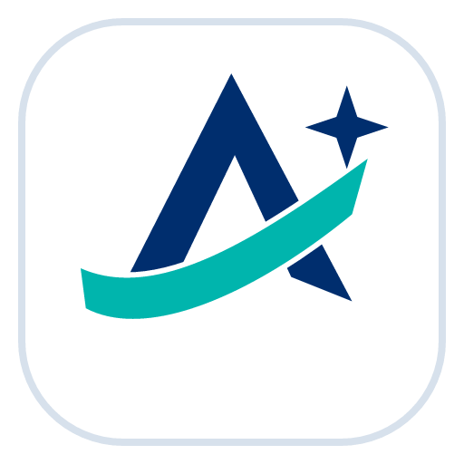

# Achmage HOP



HWP·HWPX 문서를 Windows·macOS·Linux에서 열고 고치고, AI와 함께 쓰는 데스크톱 워드프로세서입니다. 줄바꿈과 쪽 나눔을 한글 2024와 최대한 같게 맞추는 것을 목표로 합니다(문서에 따라 다를 수 있습니다).


Achmage HOP는 laguna821(Achmage)이 오픈소스 [HOP](https://github.com/golbin/hop)와 HWP 엔진 [rhwp](https://github.com/edwardkim/rhwp)를 바탕으로 만든 **비공식 배포판**입니다. 원본 HOP·rhwp 개발자, 한글과컴퓨터와 관계가 없으며 그들의 승인이나 보증을 받지 않았습니다.

원본 HOP는 HWP 문서를 열고 저장하는 가벼운 앱입니다. Achmage HOP는 여기에 두 가지를 더합니다.

1. **한글 2024에 맞춘 조판.** Windows·macOS·Linux 어디서나 Windows 한글 2024의 줄바꿈·쪽 나눔에 맞추도록 엔진을 고칩니다(직접 만든 시험 문서 기준, 문서에 따라 다를 수 있음).
2. **문서 작업용 AI.** 보고서·공문·회의록을 서식에 맞춰 만들고, 열린 문서를 AI와 함께 고칩니다.

## 한눈에

| 영역 | 무엇을 하나 |
|---|---|
| 조판 | rhwp 엔진 패치 12개. 직접 만든 시험 문서를 한글 2024로 인쇄한 결과와 줄·쪽·글자 위치를 비교해 맞췄습니다 |
| AI 패널 | OpenAI·Anthropic·Google·xAI의 공식 CLI로 로그인해 쓰는 글쓰기 도우미. 보내기 전 개인정보 가림, 임시 사본에서 확인한 뒤 한 번에 반영·Ctrl+Z |
| 서식 | Markdown 원고를 HWPX로 조판. 기본 서식 14종, 한글 파일에서 내 서식 추가 |
| 텔레그램 | 휴대폰에서 문서 만들기, 열린 문서에 질문 (직접 켤 때만) |
| 저장 | HWPX로 저장 (저장 뒤 다시 열어 내용 확인) |
| 설치본 | Windows x64 · macOS Apple Silicon · Linux x64 |

## 원본 HOP와 달라진 점

### 1. 한글 2024에 맞춘 줄·쪽 — rhwp 패치 큐

`third_party/rhwp`(원본 엔진)는 그대로 두고, 바꾼 부분은 `patches/rhwp/`에 번호 붙은 패치로만 쌓습니다. 같은 패치가 화면용 WASM(`apps/studio-host/vendor/rhwp-core`)과 PDF용 네이티브 빌드(`vendor/rhwp-native`, `scripts/achmage/sync-rhwp-native.py`로 생성)에 함께 들어가므로 화면과 PDF의 줄바꿈이 같습니다. 패치 해시는 시험(`tests/rhwp-patch-queue.test.mjs`)으로 묶여 있어 한쪽만 바뀌면 실패합니다.

각 패치는 직접 만든 시험 문서를 한글 2024에서 인쇄해 쪽 수, 쪽마다 줄 수, 줄 첫 글자, 기준선, 글자 위치를 재고, 한 번에 조건 하나만 바꿔 가며 같은 결과가 나오도록 맞춘 것입니다(모든 문서에서 같다는 뜻은 아닙니다).

| 패치 | 내용 |
|---|---|
| 0001 | 한림고딕체 글자 폭. rhwp가 모르는 글꼴을 1.0em으로 어림하던 것을 실제 폭으로 바꿔 줄바꿈 위치를 맞춤 |
| 0002 | 내어쓰기 위치에 걸리는 자동 탭 |
| 0003 | 굵은 꼴이 따로 없는 글꼴(한림고딕 등)의 합성 굵게를 화면에도 |
| 0004 | 레이아웃 정보에 글자 기준선 제공 |
| 0005 | 줄을 끝내는 문자의 크기도 줄 높이에 반영 |
| 0006 | HWPX 기본 탭 간격(`tabStopVal`)과 문단 안 탭 |
| 0007 | 외톨이줄·과부줄 보호, 다음 문단과 함께 넘기기 |
| 0008 | 빈 문단에 붙은 표 다음 본문 위치 |
| 0009 | HWPX 여백 단위 |
| 0010 | 줄 끝 공백을 오른쪽 여백 밖에 매달아 양쪽 정렬 줄 끝을 맞춤 |
| 0011 | 탭이 든 양쪽 정렬 줄의 간격 배분 |
| 0012 | 원본 정보가 없는 새 HWPX 문서에는 만든 프로그램을 Achmage HOP로 적음 |

작업 순서는 [docs/rhwp-patch-queue.md](docs/rhwp-patch-queue.md)에 있습니다.

### 2. AI 글쓰기 패널

- **제공사 4곳**: OpenAI(Codex CLI), Anthropic(Claude Code CLI), Google(Antigravity CLI의 Gemini), xAI(Grok CLI).
- **채팅 로그인은 각 회사의 공식 CLI로 합니다.** 이 앱은 이 컴퓨터에 설치된 공식 CLI(Claude는 수정하지 않은 공식 Claude Code)를 실행하고, 로그인은 그 CLI가 여는 각 회사의 화면에서 합니다. 앱은 로그인 정보(비밀번호·토큰)를 읽거나 보관하거나 중계하지 않습니다. Claude는 로그인할 때 Claude 구독(Pro·Max)과 Anthropic Console 계정(API 사용량 과금) 중에서 고릅니다. 앱은 AI 제공사의 API 키를 받지 않고, 다른 프로그램의 로그인 정보 파일을 읽거나 복사하지 않습니다. 로그인 정보는 각 CLI가 이 컴퓨터에 보관하므로 한 번 로그인하면 유지되고, 마지막에 쓴 제공사도 기억합니다. Claude 로그인 정보는 앱 데이터 폴더 안의 앱 전용 Claude Code 프로필에, Linux의 Codex 로그인 정보는 앱 데이터 폴더의 파일로 저장됩니다.
- **CLI 실행 방식**: Claude는 도구와 MCP를 끈 상태로, Grok은 파일·터미널 접근 없이 MCP 서버를 연결하지 않은 상태로, Codex는 읽기 전용에 도구 요청을 거절하는 방식으로, Gemini는 계획(plan)·샌드박스 모드로 실행합니다. 앱은 도구 실행 요청을 승인하지 않습니다. 다만 제공사 CLI에 남아 있는 일부 내장 기능까지 막는다고 보장하지는 않습니다.
- **문서 작업 AI**: 채팅창과 선택 영역 편집이 같은 방식으로 동작합니다. AI가 문서를 문단·표 칸 단위로 나눠 읽고, 바꿀 내용을 앱 안의 임시 사본에서 먼저 적용해 확인한 뒤 열린 문서에 한 번에 반영합니다(Ctrl+Z 한 번). 그사이 문서가 바뀌었으면 반영하지 않습니다.
  - 할 수 있는 일: 문단·표 칸 글 고치기와 채우기(선택하지 않아도 항목 이름으로 찾음), 표의 행·열 추가·삭제와 칸 합치기·나누기, 실제 체크박스 켜고 끄기, 선택한 글자의 서식, 설치된 글꼴 이름 찾기, 서식으로 새 문서 만들기와 다시 구성하기.
  - 아직 대상이 아닌 것: 표 안의 표, 글상자, 머리말·꼬리말, 그림.
  - 한 요청에 AI와 최대 24번 주고받습니다. 매번 요청 문장(1만 2천 자까지), 이 대화의 첫 요청과 최근 대화(최대 4만 8천 자), 이 대화에서 앞서 보낸 요청들의 앞부분(160자씩, 최근 24개), 선택한 글 전체(선택이 있을 때), 문서 앞부분(약 2만 자), 최근 작업 결과(AI가 읽은 문서 부분 포함), 서식 이름 목록이 개인정보를 가린 뒤 고른 AI 제공사로 갑니다. AI는 필요하면 열린 문서의 다른 부분과 앞서 보낸 요청 원문을 더 읽고 이 컴퓨터에 설치된 글꼴 이름을 조회하므로, 문서 전체가 갈 수 있습니다. 새 문서 작성·다시 구성을 맡기면 작성 요청이 한 번 더 가며, 여기에도 최근 대화(최대 4만 8천 자)가 함께 갑니다. 다시 구성은 확인 없이 반영되고 Ctrl+Z 한 번으로 되돌립니다. AI는 서식 창에서 고른 서식이나 요청에서 이름을 말한 서식만 씁니다. 문서가 길거나 작업이 많으면 그만큼 사용량이 늘어납니다.
- **대화**: 앱을 켜면 빈 대화로 시작하고, 이 컴퓨터에 남은 대화는 계정 메뉴의 「이전 대화 불러오기」로 다시 불러옵니다. 패널 위 「새 대화」는 확인을 받은 뒤 이 컴퓨터의 대화 기록(모든 제공사)을 지웁니다. 제공사를 바꿔도 대화는 이어지며, 이때 지금까지의 대화와 앞서 보낸 요청(다른 제공사와 주고받은 내용 포함)이 새로 고른 제공사로 갑니다.
- **보내기 전 개인정보 가림**: 주민·외국인등록번호, 전화번호, 이메일, 카드·계좌·여권 번호를 형식으로 찾아 표식으로 바꿔 보내고, 답을 받은 뒤 이 컴퓨터에서 원래 값으로 되돌립니다. 형식으로 알아볼 수 있는 것만 가리므로 이름·주소·학번 등은 가리지 않으며, 형식이 다르면 놓칠 수 있습니다.
- **내 정보**(이름·소속·연락처)는 컴퓨터에만 둡니다. AI는 `{{작성자}}` 같은 자리표시만 쓰고 앱이 채웁니다.
- **자료 검색**(직접 누를 때만): OpenAlex, Crossref, KCI, RISS, ScienceON, NTIS, OpenDART, NAVER, PubMed, Europe PMC, Web of Science, 법령 MCP(제3자 운영), KOSIS MCP(운영자를 확인하지 못한 제3자 시범 서버), 사용자가 지정한 MCP 서버(고급).
  - Crossref·OpenAlex·RISS·PubMed·Europe PMC는 설정 없이 바로 검색합니다.
  - **연결 설정**(🔧 버튼)에서 소스마다 카드로 키를 넣고 「저장하고 연결 시험」으로 확인합니다. 키는 OS 자격 증명 저장소에만 두며, 화면에는 「저장됨」으로만 보입니다.
  - 법령·KOSIS MCP는 「연결 켜기」를 체크하면 바로 저장되고, 그 뒤 검색하거나 「저장하고 연결 시험」을 누를 때 등록된 주소(제3자 서버)로 연결합니다(기본 꺼짐, 법령은 OC 값 필요, 1.0.0에서 주소를 저장했다면 켜진 상태로 이어짐). 켜면 검색창에서 그 서버의 검색 도구로 찾고, 어떤 도구로 찾았는지 결과에 표시합니다. 서버의 다른 도구는 카드의 「고급: 도구 직접 실행」에서 씁니다.
- 금액 한글 표기와 요일 붙은 날짜 계산.

**제공사 약관**: OpenAI·Anthropic·Google·xAI는 Achmage HOP와 관계가 없으며 이 앱을 승인하지 않았습니다. 각자의 구독이나 계정을 타사 앱에서 공식 CLI로 쓰는 것이 허용되는지는 제공사마다 다르므로, 약관 준수는 각 사용자의 몫입니다. 사용자가 각 약관을 확인하고 따라야 합니다. Gemini는 이 컴퓨터의 Antigravity CLI 로그인을 함께 쓰며, 앱에서 연결을 끊어도 CLI 로그인은 유지됩니다.

### 3. 서식으로 문서 만들기 — Kordoc 엔진

- `apps/kordoc-engine`: Markdown 원고를 HWPX로 조판하는 로컬 엔진입니다([kordoc](https://www.npmjs.com/package/kordoc) 4.21.31 기반). 표지·차례, 미리보기, 검증까지 컴퓨터 안에서 합니다.
- **기본 서식 14종**
  - 공문서 형식 9: 보고서, 기안문·시행문, 보도자료, 계획서, 정부 표준 개조식, 업무보고, 방침서, 통지·안내, 회의록
  - 기관 문서 모양 2: 한림대 일송자유교양대학(회의록·회의자료), 한림대 AI융합연구원 보고서
  - 문서 스타일 3: Kordoc 기본, 한국언론학회, 청소년학
  - 모두 실제 문서의 글꼴·크기·간격을 참고해 만든 **비공식** 서식입니다. 서울시·한림대·각 학회가 배포하거나 인증한 공식 서식 파일이 아닙니다.
- **한글 파일로 서식 추가**(서식 메뉴 → 서식 추가하기): HWP·HWPX 문서를 열어 글꼴·크기·정렬·줄 간격·용지를 읽고 내 서식으로 저장합니다. AI를 쓰지 않습니다. 기본 서식은 숨길 수 있습니다.
- **긴 원고 그대로 조판**: 8,000자가 넘는 원고를 "아래 텍스트를 선택한 템플릿으로 만들어"와 함께 붙이면, AI가 다시 쓰지 않고 원고 그대로 서식에 맞춰 조판합니다.
- **열린 문서를 다른 서식으로**
  - 서식 창의 「지금 문서에 서식만 적용」은 글 내용은 그대로 두고 제목·본문·표 서식만 고른 서식에 맞춥니다. AI를 쓰지 않고 로그인도 필요 없습니다.
  - 채팅으로 「현재 문서 전체를 이 서식으로 다시 구성해줘」처럼 요청하면 AI가 요청을 이해해 서식 엔진 작업을 고릅니다(AI 로그인 필요). 내용 변경이 없는 다시 구성이면 앱이 열린 문서의 제목·항목·표를 읽어 표지·목차까지 조판하고, AI는 글을 다시 쓰지 않습니다(앱이 읽는 문서 글자 16MiB, 표 하나에 5,000행·500열·20만 칸까지. 만든 HWPX가 압축 8MiB를 넘으면 만들지 않습니다). 문장은 그대로이고, 번호·기호(1., 가., □ 등)는 서식의 목록 모양으로, 머리말·꼬리말은 서식의 것으로 바뀌며, 기호 글꼴 문자는 〓로 표시합니다(결과 안내에 알려 줍니다). 제목이나 장 제목을 찾지 못하면 표지·목차 없이 조판합니다.
  - 내용까지 고치라고 하면("요약해서", "고쳐서", "영어로", "공손하게" 등) 문서 전체(약 25만 자까지)를 블록 번호와 함께 AI에 보내고, AI는 바꿀 블록만 답하며 나머지 블록은 앱이 원문 그대로 둡니다. 그래서 AI 답은 고친 분량만큼만 길어집니다. 보내기 전에 개인정보 가림이 적용됩니다. 서식 팩을 고른 경우에는 서식만 바꿀 때도 AI가 문서를 팩의 구성에 맞춥니다.
- **서식 팩**: 누름틀이 있는 HWPX 양식이나 양식 묶음(ZIP)을 불러와 내 정보로 채웁니다.

### 4. 텔레그램으로 휴대폰에서

- 직접 켤 때만 동작합니다. 봇 토큰은 OS 자격 증명 저장소에 두고, 연결 코드를 데스크톱에서 승인해야 하며, 1:1 대화만 받습니다. 연결할 수 있는 사람은 주인 한 명뿐입니다(이 PC에 로그인된 AI 계정을 다른 사람이 쓰지 않도록).
- 휴대폰에서 HWPX 문서를 만들고, 데스크톱에 열린 문서에 대해 물을 수 있습니다. 창을 닫아도 백그라운드에서 받을 수 있습니다.
- AI에 보낼 때는 개인정보를 가리지만, 텔레그램으로 돌려받는 답과 파일에는 원래 값이 들어 있고 텔레그램 서버를 거칩니다. 열린 문서의 이름도 텔레그램으로 전송됩니다.

### 5. 저장과 안전장치

- **HWPX로 저장**: 원본 HOP는 HWPX 문서를 HWPX로 저장하지 않았습니다. Achmage HOP는 HWPX로 저장한 뒤 다시 열어 구역·문단·개체·글자·글꼴 이름이 같은지 확인하고 나서야 저장을 끝냅니다.
- 편집을 되돌릴 수 없는 상황이면 편집 전 문서를 엽니다.

### 6. 세 OS

- 시작할 때 글꼴을 기다리지 않고 화면부터 띄웁니다. 글꼴 목록·읽기, 미리보기, AI 패널은 화면을 멈추지 않도록 백그라운드에서 처리합니다.
- 자동 업데이트는 없습니다. 새 판은 Releases에서 받습니다.

## 설치

[Releases](../../releases/latest)에서 받습니다. 설치본에는 코드 서명이 없습니다.

- **Windows x64**: `…_x64-setup.exe`를 실행합니다(내 계정에만 설치, 관리자 권한 불필요). SmartScreen 경고가 뜨면 「추가 정보 → 실행」을 누릅니다.
- **macOS (Apple Silicon)**: `.dmg`를 열어 Applications로 끌어 놓습니다. 처음 실행이 막히면 「시스템 설정 → 개인정보 보호 및 보안 → 그래도 열기」를 누릅니다. 「손상됨」이라고 나오면 터미널에서 다음을 실행합니다.

  ```bash
  xattr -dr com.apple.quarantine "/Applications/Achmage HOP.app"
  ```

- **Linux x64**: `.deb`를 `sudo apt install ./파일.deb`로 설치합니다. 다른 배포판은 아래 「직접 빌드하기」로 만들 수 있습니다.

AI 패널은 패널의 안내에 따라 각 회사의 공식 CLI로 로그인한 뒤 씁니다.

## 글꼴

설치본과 저장소에는 한컴 글꼴이 들어 있지 않습니다. `assets/fonts/`에는 원본 HOP가 배포하던 공개 글꼴만 있습니다(라이선스는 [assets/fonts/FONTS.md](assets/fonts/FONTS.md)).

- 앱은 운영체제에 설치된 글꼴을 씁니다. 글꼴은 각 글꼴의 사용권 범위 안에서 설치해 쓰세요.
- HY·휴먼 글꼴처럼 다른 프로그램과 함께 설치되는 글꼴은 이 컴퓨터에 이미 설치되어 있을 때만 그 설치본을 읽어 화면에 씁니다. 앱은 이런 글꼴 파일을 설치 파일에 넣거나 따로 복사해 두지 않습니다.
- 문서가 지정한 글꼴이 없으면 비슷한 글꼴로 대신 그리므로 줄바꿈·쪽 나눔이 달라질 수 있습니다.

## 개인정보와 네트워크

- **앱을 켜면**(AI 패널은 기본으로 열려 있음) 이 PC에 설치된 공식 CLI를 실행해 로그인 상태와 모델 목록을 확인합니다. 이때 각 CLI가 제공사 서버에 접속할 수 있습니다. 문서 내용은 보내지 않습니다.
- AI에 보내는 글은 고른 제공사의 공식 CLI를 거쳐 그 회사로 가며, 보내기 전에 위에 적은 형식의 개인정보를 가립니다.
- 자료 검색은 누를 때만 해당 서비스로 질의가 갑니다. 법령 MCP는 제3자(`mcp.gomdori.app`)가 운영하며, 켜면 OC 값(주소의 쿼리 문자열로 전송되어 그 서버의 접속 기록에 남을 수 있음)과 검색어가 그 서버로 갑니다. 국가법령정보 공동활용(open.law.go.kr)에서 받은 OC 값을 제3자 서버에 맡겨도 되는지는 그 약관을 확인하세요. KOSIS MCP(`kosismcp2026.vercel.app`)는 운영 주체를 확인하지 못한 제3자 서버입니다. 각 서비스의 이용 조건은 그 서비스 약관을 따릅니다.
- Gemini 연결 관리에서 「설치」를 누르면 Google 서버에서 Antigravity CLI 실행 파일(약 190MB)을 받아 앱 폴더에 설치합니다. 이 CLI에는 Google 약관이 적용됩니다.
- 텔레그램을 켜면 메시지와 파일이 텔레그램 서버를 거칩니다.
- 대화 기록과 내 정보는 이 컴퓨터의 앱 저장소에 남습니다. 공식 CLI도 자체 기록을 남길 수 있습니다(Claude는 기록을 끄고 실행, Codex는 임시 대화, Gemini(Antigravity CLI)는 요청 단계마다 새 대화로 남을 수 있음).
- Linux에서는 ChatGPT 앱이 `/usr/lib/chatgpt`에 설치한 Codex를 PATH의 Codex보다 먼저 씁니다(그 경로가 관리자 소유이고 다른 사용자가 쓸 수 없을 때만).

## 아직 안 되는 것

- 변경 추적, 한자 변환, 매크로
- 모든 문서가 한글 2024와 같지는 않습니다. 특히 수식 위치와, 문서가 지정한 글꼴이 없는 환경의 줄·쪽은 다를 수 있습니다.
- 열린 문서를 다른 서식으로 다시 조판할 때 그림·도형·수식·각주·미주·필드 등 표 이외의 개체가 있거나 표 안에 표·개체가 있는 문서는 아직 지원하지 않습니다. 머리말·꼬리말은 새 서식의 것으로 바뀝니다. 표의 병합 칸은 첫 칸에 내용을 두고 나머지를 비우며, 여러 줄로 된 칸은 한 줄로 잇습니다(결과 안내에 개수를 알려 줍니다).
- macOS Intel, Linux arm64 설치본은 아직 없습니다. macOS 판에는 원본 HOP의 Quick Look 미리보기가 들어 있지 않습니다.

## 버전 기록

| 버전 | 내용 |
|---|---|
| 0.4.5-achmage.1–.9 | 비공개 시험판. AI 패널과 제공사 4곳, 서식 엔진, 개인정보 가림, HWPX 저장, 텔레그램, rhwp 패치 0001–0011, 세 OS 설치본, 긴 원고, 한글 파일로 서식 추가, 로그인 유지, 시작 속도 개선 |
| 1.0.0 | 첫 공개판. 패치 0012, 오픈소스 고지 파일 |
| **1.2.0-beta.5** | 시험판. 문서 작업 AI: 채팅창과 선택 영역 편집이 같은 방식으로 문서를 나눠 읽고, 임시 사본에서 확인한 뒤 한 번에 반영(표 칸 채우기, 행·열 추가·삭제·합치기·나누기, 실제 체크박스, 선택한 글자 서식, 설치 글꼴 찾기). 「새 대화」와 「이전 대화 불러오기」, Claude 모델 목록, Claude 응답 중 사용량 알림으로 실패하던 문제 수정, Linux에서 ChatGPT 앱의 Codex 우선. 설치 파일 경량화(조판 엔진을 한 파일로 묶음, 릴리스 빌드 LTO·기호 제거, macOS dmg lzfse 압축). Linux에서 실사용 시험(1.2.0-beta.4 빌드). beta.5는 Windows에서 빌드·실행과 조판 엔진 결과를 확인했고, Windows·macOS에서 새 AI 작업의 실사용 시험은 아직입니다 |
| 1.1.0 | 긴 문서: 열린 문서를 다른 서식으로 바꿀 때 AI가 다시 쓰지 않고 앱이 조판(내용을 고칠 때는 바뀐 블록만 AI가 답함), 표 256칸·48KiB 등 분량 상한을 크게 늘림(읽는 문서 16MiB까지), 내 서식의 날짜 문단 오류 수정, AI 응답을 2분 무응답·최대 15분까지 기다림. 자료 검색 연결 설정(소스별 카드, 연결 시험, 법령·KOSIS 연결 켜기와 검색창 검색). Achmage 앱 아이콘 |

## 직접 빌드하기

필요한 것: Node 24, pnpm(corepack), Rust(`config/rhwp-upstream.json`의 버전), Python 3. Linux는 WebKitGTK 개발 패키지도 필요합니다(`scripts/achmage/build-local-installer.sh` 머리말 참고).

```bash
git clone --recurse-submodules <이 저장소 주소>
```

macOS·Linux는 스크립트 하나로 설치본을 만듭니다.

```bash
bash scripts/achmage/build-local-installer.sh ~/Downloads/achmage-hop-installers
```

Windows에서나 단계를 직접 밟을 때는 다음 순서입니다.

```bash
corepack enable
pnpm install --frozen-lockfile
pnpm --dir apps/kordoc-engine install --frozen-lockfile --ignore-workspace --no-optional --ignore-scripts
node scripts/achmage/prepare-kordoc-runtime.mjs
python3 scripts/achmage/sync-rhwp-native.py
node scripts/achmage/third-party-notices.mjs
cd apps/desktop
pnpm tauri build --config src-tauri/tauri.achmage.conf.json --config src-tauri/tauri.achmage.release.conf.json
```

원본 HOP의 개발 환경 설명은 [docs/DEVELOPMENT.md](docs/DEVELOPMENT.md)에 있습니다.

## 저장소 구조

| 경로 | 내용 |
|---|---|
| `apps/studio-host/src/achmage-ai/` | AI 패널, 서식, 서식 추가, 개인정보 가림 |
| `apps/desktop/src-tauri/` | 데스크톱 앱(Rust, Tauri 2): 저장, 글꼴, PDF, 텔레그램 |
| `apps/desktop/achmage-*` | 제공사 연결, 자료 검색, 텔레그램 등 crate |
| `apps/kordoc-engine/` | Markdown → HWPX 조판 엔진 |
| `patches/rhwp/` | rhwp 패치 큐 |
| `apps/studio-host/vendor/rhwp-core/` | 패치를 적용해 빌드한 WASM |
| `third_party/rhwp/` | 원본 rhwp (수정하지 않음) |
| `licenses/` | 함께 배포하는 구성 요소의 라이선스 원문 |

## 상표

'한글', '한컴', 'HWP', 'HWPX'는 ㈜한글과컴퓨터의 상표 또는 등록 상표입니다. Achmage HOP는 한글과컴퓨터와 제휴·후원·승인 관계가 없습니다. 문서 형식 처리는 rhwp가 맡으며, rhwp는 한글과컴퓨터가 공개한 한글 문서 파일(.hwp) 형식 문서를 참고해 개발했다고 밝히고 있습니다. OpenAI, ChatGPT, Codex, Anthropic, Claude, Google, Gemini, Antigravity, xAI, Grok, Telegram은 각 회사의 상표입니다. 'Achmage'와 'Achmage HOP'라는 이름, `assets/achmage/logo/`의 아이콘은 laguna821이 이 배포판을 나타내는 표지로 씁니다('HOP'는 원본 HOP 프로젝트의 이름입니다). MIT 라이선스는 코드와 파일(아이콘 파일 포함)의 저작권 이용을 허락할 뿐, 이 이름과 아이콘을 다른 제품이나 배포판을 가리키는 표지(상표)로 쓸 권리는 주지 않습니다. 고쳐서 따로 배포할 때는 다른 이름과 아이콘을 쓰세요.

## 감사의 말과 라이선스

- [HOP](https://github.com/golbin/hop)와 [rhwp](https://github.com/edwardkim/rhwp)를 공개해 주신 개발자분들께 감사드립니다. 이 저장소는 그 위에서 출발했습니다.
- 패널 디자인 일부와 자료 검색 어댑터는 CMDS Achmage(MIT)를 바탕으로 했습니다. CMDS Achmage는 Smart Composer(© 2024 Heesu Suh, MIT)에서 갈라져 나왔고, 그 라이선스 전문을 해당 디렉터리(`LICENSE-CMDS`, `CMDS-LICENSE`)에 함께 둡니다.
- 문서 스타일 코드는 HanMark(MIT, Achmage)에서 옮겨 왔습니다. 문서 조판은 [kordoc](https://www.npmjs.com/package/kordoc)(MIT)을 씁니다.
- 제공사 로그인 흐름은 Orca(MIT)와 Hermes(MIT)의 공개 코드를 참고해 새로 작성했습니다.
- 시험에 쓰는 Codex app-server 스키마는 OpenAI Codex(Apache-2.0)에서 생성했습니다(`apps/desktop/achmage-ai/tests/schema/NOTICE.md`).
- 설치본에 함께 들어가는 오픈소스 구성 요소(Rust crate, JavaScript 패키지, Node.js, 글꼴)의 라이선스는 설치 폴더와 각 릴리스의 `THIRD_PARTY_NOTICES` 파일에 있습니다.

License: MIT — [LICENSE](LICENSE)
